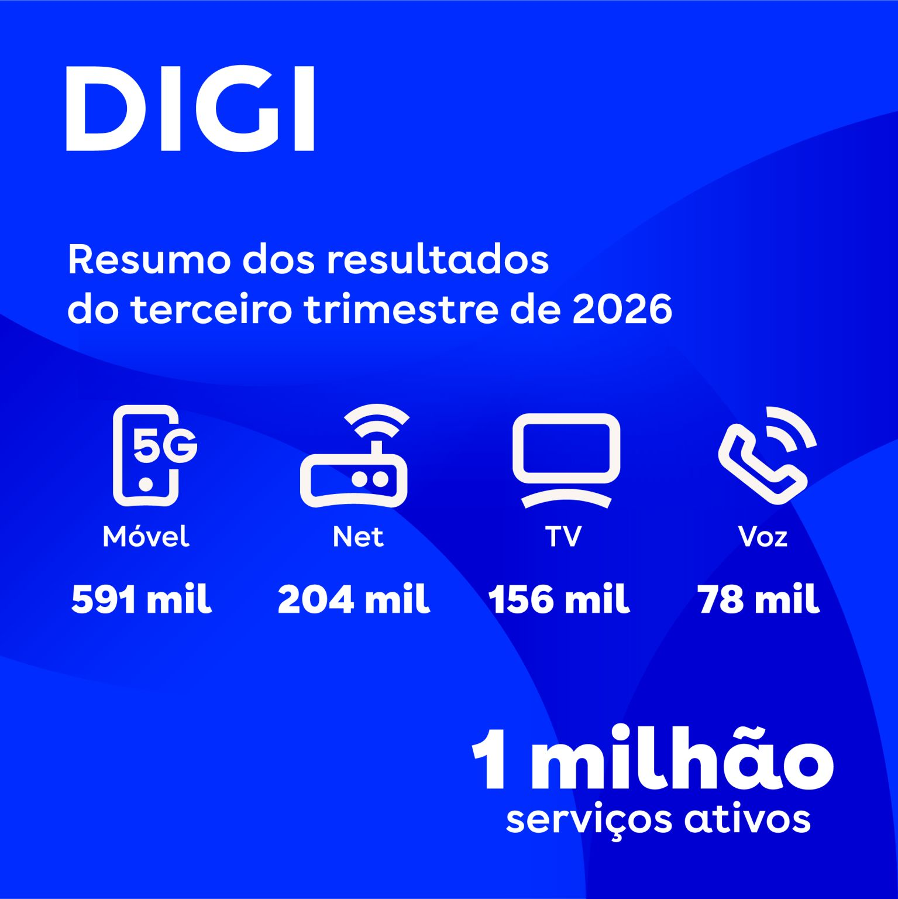
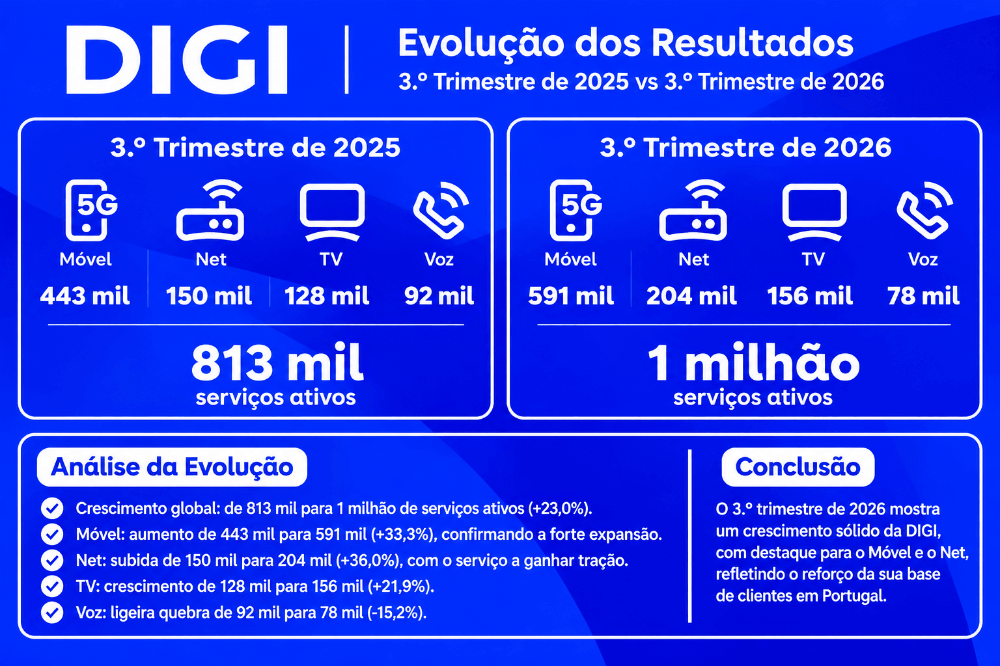

Como vem sendo habitual aqui no **Viciado Comenta**, estamos sempre atentos aos resultados trimestrais apresentados pela **DIGI Portugal**. Hoje, dia 13 de Novembro, chegaram-nos os mais recentes dados, através dos quais a DIGI quebrou oficialmente uma barreira muito relevante: **1 milhão de serviços ativos em Portugal!**

### **O crescimento**

Desde Novembro de 2024 que nada voltou a ser como antes. Se, numa primeira fase, muitos eram os que duvidavam da capacidade de crescimento desta operação, volvidos 24 meses, creio já não existirem muitas dúvidas. A DIGI veio para abalar o mercado das telecomunicações em Portugal.

Face ao 3.º trimestre de 2025, a DIGI registou um impressionante **aumento de +23% de serviços ativos**. Com 1 milhão de serviços ativos, os dados móveis e a internet fixa são claramente os principais "culpados".

Destaque para o crescimento assinalável da **internet fixa**, que cresceu **36%**, o que revela bem a capacidade de implantação da fibra da DIGI em Portugal. Com os tarifários de 500 Mbps, 1 Gbps e 10 Gbps, a operadora conseguiu adicionar **54 mil novos clientes** a este serviço (o que significa que a DIGI passou a fazer parte do quotidiano de mais algumas centenas de milhares de pessoas, fornecendo fibra ótica diretamente aos seus lares).

### **O futuro**

A operação da DIGI cresce à boleia do preço, mas também através da onda de "protesto" contra as operadoras incumbentes, que tem vindo a crescer de forma sustentada. A onda azul da DIGI continuará a expandir-se à medida que mais portugueses se libertarem das suas fidelizações e passarem a contar com a alternativa da operadora na sua morada.

### **Os desafios**

No meu ponto de vista, a DIGI necessita ainda de resolver alguns problemas-chave. Em cada um dos serviços, é possível identificar facilmente os bloqueios que estão a travar uma adesão em massa:

-   **Serviços Móveis:** A cobertura ainda algo irregular e cujo funcionamento muitas vezes deixa a desejar é um dos principais fatores que levam muitos potenciais clientes a adiar a adesão. Aliado à existência, em território nacional, das alternativas _low-cost_ ("marcas brancas") das incumbentes, a pressão é tremenda e a tolerância à falha é mínima.
-   **Internet Fixa:** A indisponibilidade de cobertura em certas zonas, bem como a ausência do serviço "Conexão Plus" - que permite ao cliente pagar uma mensalidade para lhe ser atribuído um IP público -, são hoje as principais barreiras a um crescimento ainda maior deste segmento.
-   **Serviço DIGI TV:** Apesar da recente atualização da aplicação, a mesma ainda está bastantes furos abaixo da concorrência direta. A DIGI necessita de repensar seriamente esta app, bem como de reforçar a grelha de canais.
-   **Serviço de Voz Fixa:** Aqui, a DIGI tende a sofrer com o desinteresse generalizado pelo serviço por parte dos consumidores. Além disso, a operadora debate-se com a escassez de novos blocos de numeração próprios para atribuir, o que faz com que o serviço só esteja disponível para quem já detém um número noutra operadora e pretenda fazer a portabilidade.

### **Conclusão**

A DIGI tem motivos para sorrir. Portugal é hoje um mercado onde a implantação da operadora se faz a bom ritmo. Diria que, com o amadurecimento natural da operação, o crescimento mais significativo ainda está por vir. Por agora, a operadora ocupa o 4.º lugar no ranking, mas **a chegada ao pódio não é uma questão de "se", mas sim de "quando"**.

Continuaremos a acompanhar muito atentamente todos os passos da DIGI no nosso país.
